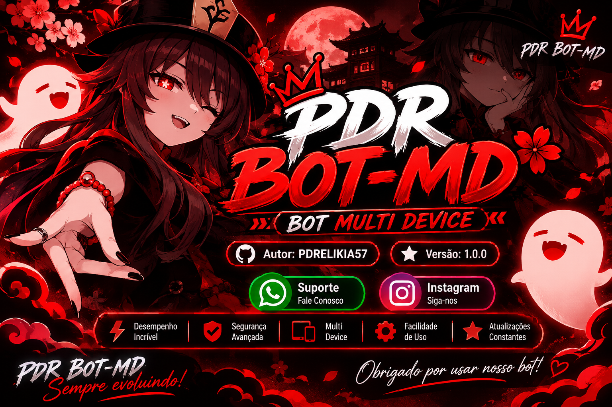

# 🌷 PDR BOT-MD ✿ V1.0.0 ✓

<p align="center">
  
</p>

<p align="center">
  
</p>

<p align="center">
  
  
  
</p>

<div align="center">

[](https://wa.me/)
[](https://instagram.com/)

</div>

## INICIAR PELO TERMUX 🌷

**Caso não tenha o Termux instalado:**

[Instale aqui](https://f-droid.org/packages/com.termux/)

## Executando comandos básicos ✨

**Após instalar o APK, execute os seguintes comandos:**

> Copie e cole apenas um comando por vez e pressione Enter.

### 1 - COMANDO 🌸
```bash
termux-setup-storage
```
> Permita que o Termux acesse seus arquivos.

### 2 - COMANDO 🌸
```bash
pkg upgrade -y && pkg update -y
```
> Se aparecer uma confirmação, digite Y e pressione Enter.

### 3 - COMANDO 🌸
```bash
pkg install -y ffmpeg nodejs-lts wget tesseract git
```

### 4 - COMANDO 🌸
```bash
cd /sdcard/PDR-BOT-MD && npm start
```
> Use esse comando sempre que quiser iniciar o bot.

### COMANDO ADICIONAL 🌸
```bash
cd /sdcard/PDR-BOT-MD && npm start up
```
> Utilize para atualizar o bot, caso essa função esteja implementada na source.

## 📞 Suporte

Entre em contato para suporte e informações.

- WhatsApp: [Fale Conosco](https://wa.me/)
- Instagram: [PDRELIKIA57](https://instagram.com/)

## ⚠️ Atenção

- Utilize o bot de maneira responsável.
- Não compartilhe informações privadas.
- Respeite os termos de uso do projeto.
- Não utilize o bot para atividades ilegais.

## ✨ Contributors

- **PDRELIKIA57** — Personalização e identidade visual.
- **Updates** — Atualizações e melhorias do projeto.

## 🚀 Features

- **Desempenho:** Projeto focado em rapidez e baixo consumo de recursos.
- **Comandos:** Sistema de comandos para WhatsApp.
- **Multi Device:** Compatibilidade com múltiplos dispositivos, conforme a source.
- **Configuração:** Personalização de mensagens e funções.
- **Segurança:** Recursos de gerenciamento e proteção de grupos, conforme implementados.

## 📄 License

Licensed under [MIT](./LICENSE).

Todos os direitos reservados.
